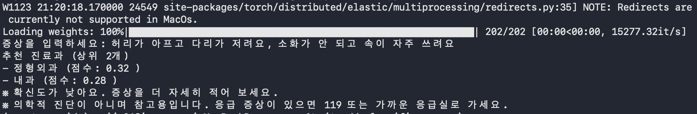

# 증상 기반 진료과 안내

증상을 한 문장으로 입력하면 어느 진료과를 고려해 볼지 안내해 주는 프로그램입니다.
Hugging Face의 zero-shot 분류 모델을 사용했습니다.

> ⚠️ 의학적 진단이 아니며 참고용입니다. 응급 증상이 있으면 119 또는 가까운 응급실로 가세요.

## 데모



## 사용한 패키지

| 패키지 | 버전 |
|---|---|
| transformers | 5.24.0 |
| torch | 2.15.0 |

- Python 3.11
- 사용 모델: `MoritzLaurer/mDeBERTa-v3-base-xnli-multilingual-nli-2mil7`

설치:

```
pip install -r requirements.txt
```

## 실행 방법

```
python main.py
```

증상을 입력하면 추천 진료과 상위 2개와 점수가 출력됩니다.
처음 실행할 때는 모델을 내려받느라 시간이 걸립니다.

## 구성

- `classifier.py`: 분류 기능 (모듈)
- `main.py`: 입력과 출력을 담당하는 실행 파일
- `test_samples.py`: 예시 문장으로 정확도를 확인하는 스크립트

## 실험 결과

직접 만든 예시 문장 8개로 후보 진료과(내과, 정형외과, 피부과, 이비인후과)를 분류했습니다.

| hypothesis_template | 정확도 |
|---|---|
| `이 증상은 {} 진료가 필요하다.` | 6 / 8 |
| `이 환자는 {}에 가야 한다.` | 3 / 8 |
| `{} 환자의 증상이다.` | 3 / 8 |

같은 모델이라도 문구에 따라 결과가 크게 달라졌고, 가장 좋았던 첫 번째 문구를 채택했습니다.

## 한계

- 예시 문장이 8개뿐이라 결과를 일반화하기 어렵습니다.
- 틀린 2개는 모두 정답이 내과였고 이비인후과로 분류되었습니다.
- 점수는 후보 간 상대 비교용이며, 1위 점수도 낮은 경우가 많습니다. (후보 4개일 때 무작위 평균은 0.25)
- 점수가 낮으면 "확신도가 낮다"는 안내를 출력합니다.
- 의료 데이터로 학습된 모델이 아니므로 실제 진료 판단에 쓸 수 없습니다.

## 참고 자료

- 모델: [MoritzLaurer/mDeBERTa-v3-base-xnli-multilingual-nli-2mil7](https://huggingface.co/MoritzLaurer/mDeBERTa-v3-base-xnli-multilingual-nli-2mil7)
- [Hugging Face Transformers 문서](https://huggingface.co/docs/transformers)